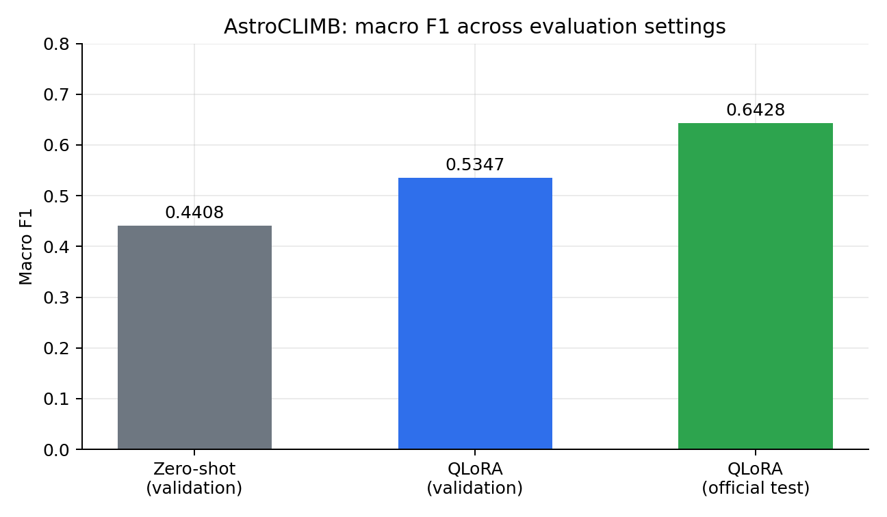
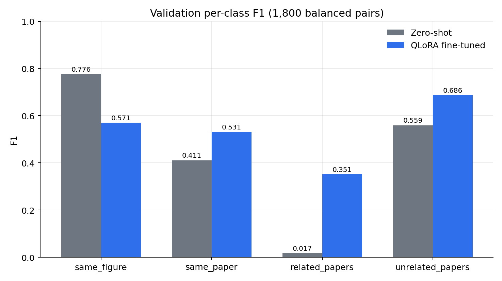

<div align="center">

# AstroCLIMB-QLoRA

**From Figures to Citation Graphs: QLoRA-Based Multimodal Linking for AstroCLIMB**

[](paper/2026.wasp-1.21.pdf)
[](pyproject.toml)
[](LICENSE)
[](https://github.com/praaajg/astroclimb-qlora/actions/workflows/ci.yml)
[](https://huggingface.co/ShivRamSaud/gemma4-e4b-qlora-astroclimb-v2-fresh)

</div>

This repository contains the paper, reference code, reproducible evaluation
utilities, and machine-readable results for our **AstroCLIMB** system at the
[4th Workshop on Artificial Intelligence for Scientific Publications (WASP
2026)](https://www.aclweb.org/). AstroCLIMB reconstructs the citation graph of
astronomy papers from pairs of scientific figures and captions **without DOI
or document metadata**.

The system fine-tunes `google/gemma-4-E4B-it` with QLoRA on 8,200 competition
training pairs and classifies each pair as `same_figure`, `same_paper`,
`related_papers`, or `unrelated_papers`.

| Highlight | Value |
|---|---|
| Zero-shot Gemma-4-E4B validation macro F1 | **0.4408** |
| Fine-tuned validation macro F1 | **0.5347** |
| Official test macro F1 (10,000 pairs) | **0.64282** |
| `related_papers` validation F1 | **0.0172 → 0.3508** |
| Adapter | [ShivRamSaud/gemma4-e4b-qlora-astroclimb-v2-fresh](https://huggingface.co/ShivRamSaud/gemma4-e4b-qlora-astroclimb-v2-fresh) |
| Dataset | [Kaggle: jcxiv42/astroclimb](https://www.kaggle.com/datasets/jcxiv42/astroclimb) |

## The task

Each input is a symmetric pair of objects. An object is either a figure image
or a caption, giving three pair types: figure–caption (`TXT-IMG`),
figure–figure (`IMG-IMG`), and caption–caption (`TXT-TXT`). At test time no
DOI, paper ID, or other metadata is available, so the relation must be inferred
from visual and textual content alone.

| Label | Meaning |
|---|---|
| `same_figure` | The caption directly describes the paired figure (figure–caption pairs only). |
| `same_paper` | Same study, different figures; compatible style, instruments, or datasets. |
| `related_papers` | One paper builds on the other; overlapping methods, datasets, or cited prior results. |
| `unrelated_papers` | No clear link in topic, instruments, scale, or style. |

The primary metric is **macro F1**, the unweighted mean of the four per-class
F1 scores.

## Method

- **Backbone.** `google/gemma-4-E4B-it`, loaded in 4-bit NF4 with double
  quantization and bf16 compute.
- **Adapter.** LoRA on attention and MLP projections, rank `r=64`,
  `alpha=128`, dropout `0.05`, effective scaling 2.
- **Input.** A single descriptive system prompt, then per-object content
  blocks (images before their corresponding text), captions truncated to
  2,000 characters, images resized to 448×448.
- **Training.** 8,200 rows after holding out a balanced 1,800-pair validation
  split (450 per class, seed 42). AdamW, learning rate `1e-4`, cosine schedule
  with 5% warmup (204 steps), per-device batch 2 × gradient accumulation 8,
  max sequence length 1,536, at most 2,560 steps, early stopping (patience 3,
  threshold 0.001, evaluated every 200 steps). Best validation loss `0.3464`
  at step 1,000.
- **Decoding.** Greedy, `max_new_tokens=32`, case-insensitive regex mapping
  from the generation to a label, falling back to `unrelated_papers`.

The full prompt is reproduced verbatim in
[`src/astroclimb/prompt.py`](src/astroclimb/prompt.py) and in Appendix A.1 of
the paper.

## Results



### Validation split (1,800 balanced pairs)

| System | Macro F1 | Accuracy |
|---|---:|---:|
| Gemma-4-E4B, zero-shot | 0.4408 | 0.5206 |
| Gemma-4-E4B, 4-shot | 0.3925 | 0.5050 |
| Qwen3-VL-8B-Thinking, zero-shot | 0.1068 | 0.2461 |
| SmolVLM-500M, zero-shot | 0.1723 | 0.2511 |
| GLM-4.6V-Flash, zero-shot (610 rows) | 0.1020 | 0.2557 |
| **Gemma-4-E4B + QLoRA (submitted)** | **0.5347** | **0.5483** |

Per-class F1 for the fine-tuned adapter:
`same_figure 0.5705`, `same_paper 0.5311`, `related_papers 0.3508`,
`unrelated_papers 0.6864`.



### Official test split (10,000 pairs)

| Metric | Value |
|---|---:|
| Macro F1 | **0.64282** |
| Predicted class counts (sf / sp / rp / up) | 684 / 3,005 / 2,058 / 4,253 |
| `same_figure` precision / recall | 0.9386 / 0.6420 |
| `same_paper` precision / recall | 0.6453 / 0.6463 |
| `related_papers` precision / recall / F1 | 0.5573 / 0.3823 / 0.4535 |

The dominant error mode is asymmetry between `same_figure` and `same_paper`:
333 of the 358 missed `same_figure` test pairs were predicted as `same_paper`.
Figure–figure pairs remain the hardest subset for `related_papers` (F1 0.3166).
See [`docs/results.md`](docs/results.md) for all tables and the confusion
analysis.

## Quick start

```bash
git clone https://github.com/praaajg/astroclimb-qlora.git
cd astroclimb-qlora
python -m venv .venv
source .venv/bin/activate          # Windows: .venv\Scripts\activate
pip install -e ".[dev]"            # CPU-only utilities and tests
```

For GPU training and inference, install the model extras:

```bash
pip install -e ".[train]"
```

### 1. Get the data

Download the competition release from Kaggle (a Kaggle API token is required):

```bash
python scripts/download_data.py --output data/raw
```

### 2. Run inference with the released adapter

```bash
astroclimb-infer \
  --config configs/qlora.yaml \
  --input data/raw/test.csv \
  --adapter ShivRamSaud/gemma4-e4b-qlora-astroclimb-v2-fresh \
  --output outputs/test_predictions.csv
```

The expected input schema is documented in
[`docs/reproducibility.md`](docs/reproducibility.md). Predictions are written
one-hot in the required `same_figure`, `same_paper`, `related_papers`,
`unrelated_papers` column order.

### 3. Evaluate

```bash
astroclimb-evaluate \
  --gold data/raw/labels.csv \
  --pred outputs/test_predictions.csv \
  --output outputs/metrics.json
```

### 4. Reproduce training

```bash
astroclimb-train --config configs/qlora.yaml
```

The reference trainer implements the protocol described in the paper on a
single 80 GB GPU. See [`docs/reproducibility.md`](docs/reproducibility.md) for
hardware notes, expected runtime, and the exact hyperparameter mapping.

> **Implementation status.** The paper's artifact appendix states that the
> original training and preprocessing scripts were not released. This
> repository is a clean-room reference implementation reconstructed from the
> paper's protocol. It is not the authors' original competition code. Numbers
> reported in the paper are preserved under `results/`; differences introduced
> by reimplementation should be reported in a new results section, not by
> editing the paper tables.

## Repository layout

```text
astroclimb-qlora/
├── assets/                  # figures used in the README (generated)
├── configs/
│   └── qlora.yaml           # full training / inference configuration
├── docs/
│   ├── architecture.md      # data flow and model diagram
│   ├── reproducibility.md   # step-by-step protocol and data schema
│   └── results.md           # all paper tables and confusion analysis
├── paper/
│   ├── 2026.wasp-1.21.pdf   # camera-ready paper
│   └── wasp2026-astroclimb.bib
├── results/                 # machine-readable paper results
├── scripts/
│   ├── download_data.py     # Kaggle download helper
│   └── make_figures.py      # regenerate README figures
├── src/astroclimb/
│   ├── data.py              # base64 decoding, caption/image preprocessing
│   ├── evaluate.py          # macro F1, per-class metrics, confusion matrix
│   ├── infer.py             # batched inference + submission writer
│   ├── labels.py            # label parsing and fallback
│   ├── model.py             # 4-bit loading + LoRA configuration
│   ├── prompt.py            # exact prompt contract
│   ├── split.py             # seed-42 balanced validation split
│   └── train.py             # reference HF Trainer pipeline
└── tests/                   # fast, CPU-only unit tests
```

## Data and checkpoints

- Competition data: [kaggle.com/datasets/jcxiv42/astroclimb](https://www.kaggle.com/datasets/jcxiv42/astroclimb)
- Submitted adapter and test predictions:
  [ShivRamSaud/gemma4-e4b-qlora-astroclimb-v2-fresh](https://huggingface.co/ShivRamSaud/gemma4-e4b-qlora-astroclimb-v2-fresh)

The `adapter_best/` folder of the adapter repository contains
`adapter_model.safetensors`, `adapter_config.json`, tokenizer/processor
configs, and training arguments. The `submission/` folder contains the scored
10,000-row test predictions.

## Citation

```bibtex
@inproceedings{ghimire2026astroclimb,
  title     = {{PSGS}@2026: From Figures to Citation Graphs: {QLoRA} Based
               Multimodal Linking for {AstroCLIMB}},
  author    = {Ghimire, Prajwal and Saud, Shiv Ram and Mahato, Aashish and
               Dawadi, Sandeep and Saud, Ramesh and Regmi, Sunil and
               Shakya, Manoj},
  booktitle = {Proceedings of the 4th Workshop on Artificial Intelligence for
               Scientific Publications (WASP 2026)},
  pages     = {192--198},
  year      = {2026},
  month     = nov,
  publisher = {Association for Computational Linguistics}
}
```

A `CITATION.cff` is provided for GitHub's citation widget.

## License

Code and documentation are released under the [MIT License](LICENSE). The
paper PDF is © 2026 the Authors and the Association for Computational
Linguistics; it is included for archival convenience. Dataset and model
weights retain their original licenses.

## Acknowledgements

We thank the AstroCLIMB organizers at WASP 2026 for the competition release and
leaderboard, and the Data Science & Artificial Intelligence Lab at Kathmandu
University for support.
