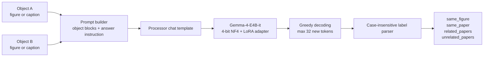
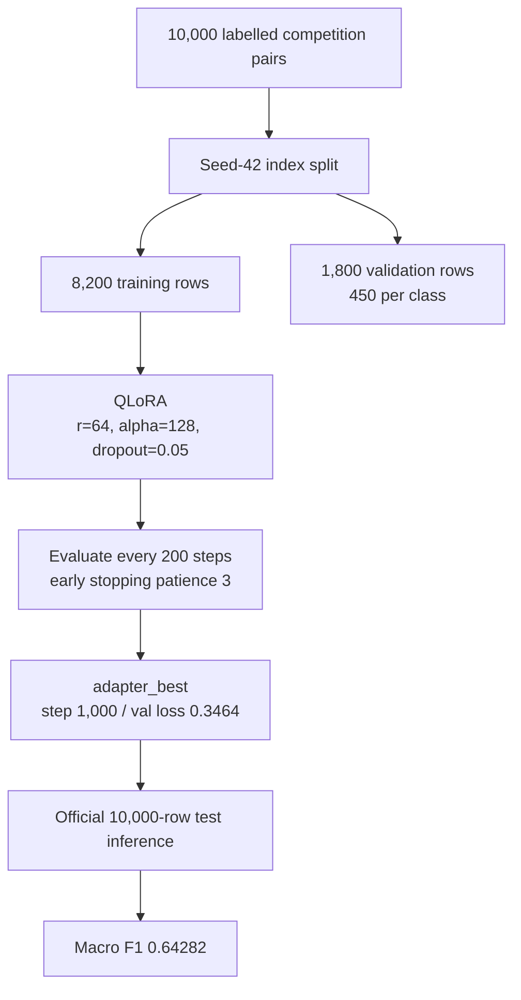

# Architecture

## Inference pipeline

The prompt is identical for training, validation, and test. Images are resized
to 448×448, captions are truncated to 2,000 characters, and no DOI or paper
metadata is provided at any point.

## Training pipeline

## Module map

| Module | Responsibility |
|---|---|
| `astroclimb.prompt` | Verbatim system prompt, object blocks, caption truncation. |
| `astroclimb.labels` | Four-label vocabulary, regex parsing, fallback. |
| `astroclimb.data` | Base64/path image decoding, 448×448 resize, type detection, CSV validation. |
| `astroclimb.split` | Balanced 450-per-class validation split with seed 42. |
| `astroclimb.model` | 4-bit NF4 loading, LoRA config, adapter attachment. |
| `astroclimb.train` | Reference `transformers.Trainer` pipeline and collator. |
| `astroclimb.infer` | Batched inference and one-hot submission writer. |
| `astroclimb.evaluate` | Macro F1, accuracy, per-class precision/recall/F1, confusion matrix. |

## Design notes

- **One prompt for all pair types.** `same_figure` is only possible for
  figure–caption pairs, but the prompt still instructs the model to judge from
  alignment instead of assuming the class is impossible. This matches the
  paper's single-prompt contract.
- **Macro F1 is the selection metric.** The competition metric weights all
  four classes equally, which is why `related_papers` matters far more than its
  10% frequency suggests.
- **Asymmetric errors.** The adapter is conservative about `same_figure`
  (validation precision 0.9945, recall 0.4000). Most missed figures are labelled
  `same_paper`. Any future calibration work should target this boundary first.
- **Why figure–figure pairs are hard.** `related_papers` recall is only 0.0867
  on validation figure–figure pairs; 104 of 150 were predicted as
  `same_paper`. Visual style similarity is an unusually strong distractor for
  citation inference.
- **No metadata shortcut.** Test pairs carry no DOI or paper identifiers, so
  the model cannot learn a citation-graph shortcut from document metadata.
