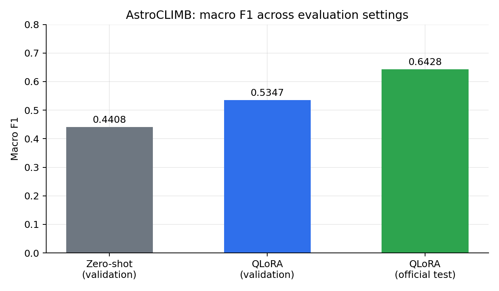
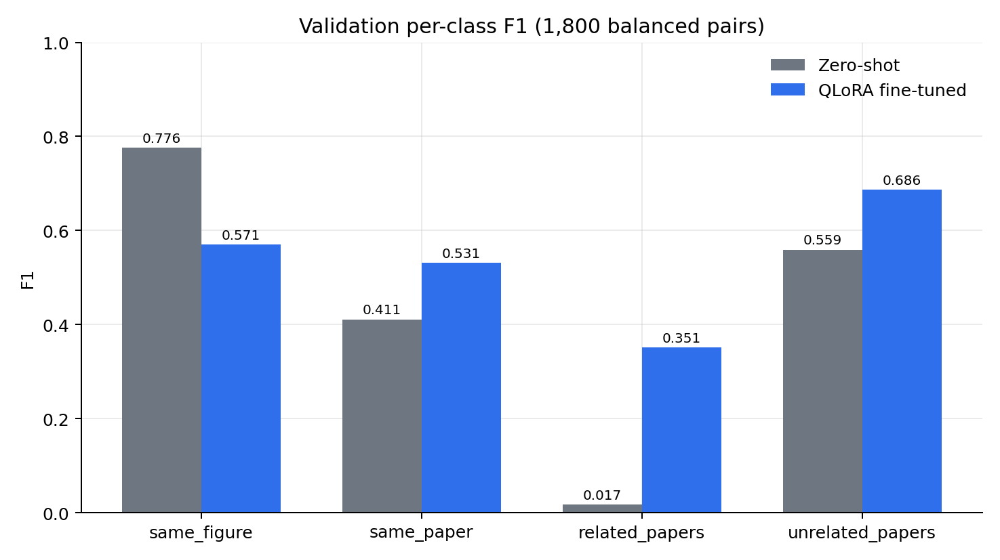
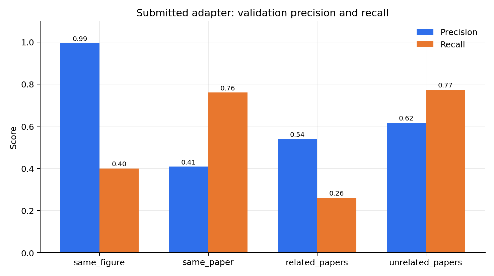

# Results

All numbers below are copied from the paper. Machine-readable versions live in
[`../results/`](../results) and are regenerated by
`python scripts/make_figures.py`.

## Headline

| Setting | Macro F1 | Accuracy |
|---|---:|---:|
| Gemma-4-E4B, zero-shot, validation | 0.4408 | 0.5206 |
| Gemma-4-E4B + QLoRA, validation | 0.5347 | 0.5483 |
| Gemma-4-E4B + QLoRA, official test | **0.64282** | — |

## Zero-shot baselines

| Model | Thinking | Rows | Macro F1 | Accuracy |
|---|---|---:|---:|---:|
| Gemma-4-E4B | no | 1,800 | **0.4408** | 0.5206 |
| Qwen3-VL-8B-Thinking | yes | 1,800 | 0.1068 | 0.2461 |
| SmolVLM-500M | no | 1,800 | 0.1723 | 0.2511 |
| GLM-4.6V-Flash | no | 610 | 0.1020 | 0.2557 |

The Qwen model collapses to `unrelated_papers`; the GLM run covers only 610
rows and is not comparable to full-split results.

## Few-shot baselines

Four demonstrations (one per class, seed 42, figure–caption pairs preferred)
and native thinking where supported.

| Model | Demos | Rows | Macro F1 | Accuracy |
|---|---:|---:|---:|---:|
| Gemma-4-E4B | 4 | 1,800 | 0.3925 | 0.5050 |
| Qwen3-VL-4B | 4 | 397 | 0.2500 | 0.3300 |
| GLM-4.1V-9B | 4 | 445 | 0.4200 | 0.5240 |

Few-shot thinking does **not** beat Gemma-4-E4B's zero-shot score on the same
rows (0.3925 vs. 0.4408). Partial-row runs are not directly comparable.

## Fine-tuned comparison

| Model | Adapter | Validation loss | Official test F1 |
|---|---|---:|---:|
| **Gemma-4-E4B** | **LoRA-64** | **0.3464** | **0.64282** |
| SmolVLM-500M | LoRA-32 | 0.3029 | 0.23675 |

Lower validation loss did not imply better test macro F1: the SmolVLM adapter
predicted no `unrelated_papers` on the official test predictions.

## Per-class F1

Validation split (1,800 rows; truncated runs are marked by pair counts):

| Run | Mode | Rows | same_figure | same_paper | related_papers | unrelated_papers |
|---|---|---:|---:|---:|---:|---:|
| Gemma-4-E4B | zero-shot | 1,800 | 0.7760 | 0.4108 | 0.0172 | 0.5593 |
| Gemma-4-E4B | few-shot | 1,800 | 0.7228 | 0.2047 | 0.0505 | 0.5918 |
| SmolVLM-500M | zero-shot | 1,800 | 0.0128 | 0.0088 | 0.3333 | 0.3341 |
| **Gemma-4-E4B** | **fine-tuned** | **1,800** | **0.5705** | **0.5311** | **0.3508** | **0.6864** |
| GLM-4.1V-9B | few-shot | 445 | 0.8653 | 0.2571 | 0.0000 | 0.5575 |
| Qwen3-VL-4B | few-shot | 397 | 0.4709 | 0.2381 | 0.0612 | 0.2286 |

The fine-tuned adapter lifts `related_papers` from near zero to 0.3508, the
paper's central result, while trading away some `same_figure` F1.

## Submitted adapter: validation precision and recall

| Class | Precision | Recall | F1 |
|---|---:|---:|---:|
| same_figure | 0.9945 | 0.4000 | 0.5705 |
| same_paper | 0.4081 | 0.7600 | 0.5311 |
| related_papers | 0.5392 | 0.2600 | 0.3508 |
| unrelated_papers | 0.6170 | 0.7733 | 0.6864 |

### Confusion analysis (validation)

- The adapter is strongly asymmetric: `same_figure` is highly precise but has
  low recall, while `same_paper` has high recall but lower precision.
- **256 of 270** missed `same_figure` pairs were predicted as `same_paper`.
- `related_papers` errors concentrate in figure–figure pairs: recall **0.0867**;
  **104 of 150** cases were predicted as `same_paper`.

## Official test behavior

| Class | Precision | Recall | F1 |
|---|---:|---:|---:|
| same_figure | 0.9386 | 0.6420 | 0.7625 |
| same_paper | 0.6453 | 0.6463 | 0.6458 |
| related_papers | 0.5573 | 0.3823 | 0.4535 |
| unrelated_papers | — | — | — |

Predicted class counts on all 10,000 test pairs:

| Class | Count |
|---|---:|
| same_figure | 684 |
| same_paper | 3,005 |
| related_papers | 2,058 |
| unrelated_papers | 4,253 |

- The predictions use all four labels rather than collapsing onto one class.
- `same_figure` precision is 0.9386 and recall 0.6420; **333 of 358** missed
  pairs were predicted as `same_paper`.
- `related_papers` remains the weakest class but improves from 0.3508 on
  validation to 0.4535 on test.
- Figure–figure pairs remain the hardest subset for `related_papers`
  (F1 **0.3166**).
- No test labels were used in training, model selection, or prompt design. The
  test analysis was performed after the leaderboard submission.

> The F1 values for `same_figure` and `same_paper` on test are derived from the
> reported precision and recall. `unrelated_papers` precision/recall were not
> reported separately, so its F1 is left blank rather than estimated.
